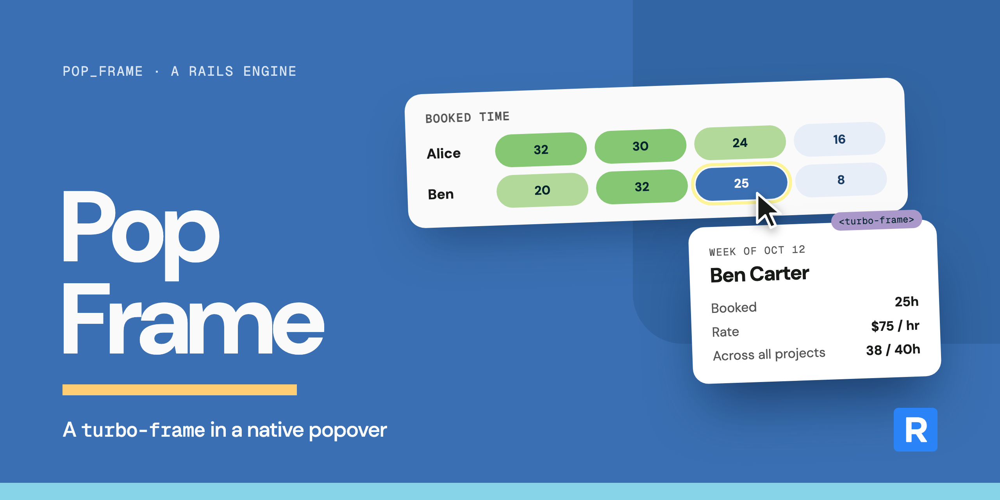

# Pop Frame

<div>
  
  
</div>
<br/>

A `turbo-frame` in a native popover, loaded the first time it opens.



Popover libraries were built for browsers that couldn't open a popover, position it, or keep it
from being clipped. Browsers can do all of that now. A JavaScript popover also has to be re-wired
every time Turbo morphs the page; a native one is just HTML, so a morph leaves it alone.

Pop Frame is one view helper and five lines of CSS. The browser handles the rest:

- The [Popover API][mdn-popover] opens and closes it, closes it on Escape or an outside click, and
  keeps `aria-expanded` up to date.
- The [top layer][mdn-top-layer] keeps it above everything, so an `overflow` ancestor can't clip it.
- [CSS anchor positioning][mdn-anchor] places it under the button that opened it.
- Turbo loads the frame and refreshes it when the page morphs.

There's no JavaScript to install, configure, or keep alive across morphs.

## Installation

```bash
bundle add pop_frame
```

Then include the stylesheet. With Propshaft or Sprockets, add it to your layout:

```erb
<%= stylesheet_link_tag 'pop_frame' %>
```

If a JavaScript bundler builds your CSS (cssbundling-rails, webpack), copy
[`pop_frame.css`](app/assets/stylesheets/pop_frame.css) into your own stylesheets instead.

## Basic Usage

Give `pop_frame_tag` an id for the frame and where to load it from. The block becomes the button's
content. (Examples use [slim] syntax.)

```ruby
= pop_frame_tag dom_id(person, :week), person_week_path(person), class: 'btn' do
  | This week
```

which renders

```html
<button type="button" popovertarget="person_1_week_popover" class="btn">This week</button>
<div id="person_1_week_popover" class="pop-frame" popover="auto">
  <turbo-frame id="person_1_week" src="/people/1/week" loading="lazy" refresh="morph">Loading…</turbo-frame>
</div>
```

The response must contain a `turbo-frame` with the same id, as with any Turbo Frame:

```ruby
= turbo_frame_tag dom_id(@person, :week) do
  = render 'people/week', person: @person
```

Nothing is fetched until the popover first opens. After that, it keeps its content between opens.
Links and forms inside it navigate the frame, just as they would in any other `turbo-frame`.

> [!TIP]
> Each frame needs an id that's unique on the page. `dom_id` with a suffix, as above, is an easy way
> to get one, even when the same record shows up in several places.

## Options

`pop_frame_tag(id, src, loading: 'Loading…', **button_options, &block)`

| Argument         | Description                                                                         | Default      |
| ---------------- | ----------------------------------------------------------------------------------- | ------------ |
| `id`             | The frame's id. The popover's id is derived from it (`"#{id}_popover"`).            | required     |
| `src`            | Where the frame loads from. Takes anything [`url_for`][url-for] does.               | required     |
| `loading:`       | Shown until the frame loads: plain text, or markup like `render 'spinner'`.         | `'Loading…'` |
| `button_options` | HTML options for the button (`class:`, `data:`, `aria:` and so on).                 | `{}`         |
| `&block`         | The button's content.                                                               | required     |

## Styling

The stylesheet only positions the popover. Its look is up to you:

```css
/* the popover */
.pop-frame { padding: 1rem; border-radius: 8px; box-shadow: 0 8px 24px #0002; }

/* its button, while open */
.btn:has(+ :popover-open) { outline: 2px solid royalblue; }

/* the frame, while it loads */
.pop-frame turbo-frame[busy] { opacity: 0.5; }
```

The popover opens below its button, aligned to the button's start edge, and flips to fit when it's
near the edge of the screen. To place it differently, override `position-area` and
`position-try-fallbacks` on `.pop-frame[popover]`.

## Page Refreshes

Pop Frame is built for pages that [refresh with morphing][turbo-morph]. When a save elsewhere on the
page (or a broadcast) morphs it:

- An open popover **stays open**, and its content is swapped for the fresh version as soon as it
  arrives, with no flash of the loading state.
- Popovers that were opened earlier and are now closed reload in the background, so they're current
  the next time they open.
- Popovers that were never opened stay unloaded.

> [!NOTE]
> Morph refreshes need `turbo_refreshes_with method: :morph` in the page's `<head>`. That helper
> writes to `content_for(:head)`, so your layout has to `yield :head`. If it doesn't, use
> `turbo_refresh_method_tag :morph` in the layout instead.

## Browser Support

Pop Frame leans on two browser features. Each one has its own [Baseline][baseline] status:

| Feature                                                                 | Needs                                                                                                    | Chrome / Edge | Safari | Firefox | Baseline                                                       |
| ----------------------------------------------------------------------- | -------------------------------------------------------------------------------------------------------- | ------------- | ------ | ------- | -------------------------------------------------------------- |
| Opens and closes, sits in the top layer, closes on Escape/outside click | [Popover API][mdn-popover]                                                                               | 114           | 17     | 125     | Newly available Jan 2025; widely available around Jul 2027     |
| Anchored under its button, flips to fit                                 | [CSS anchor positioning][mdn-anchor] ([`position-area`][mdn-position-area], [`position-try-fallbacks`][mdn-position-try]) | 129           | 26     | 147     | Newly available Jan 2026; widely available around Jul 2028     |

Browsers with the Popover API but no anchor positioning still open the popover, just centered on the
screen by the browser's default popover styles.

- **Full experience:** Chrome 129, Edge 129, Safari 26 (macOS and iOS), Firefox 147
- **Popover only, centered:** Chrome 114, Edge 114, Safari 17, Firefox 125

Opening a popover from your own JavaScript with `showPopover()` leaves it with nothing to anchor to.
Pass the button as its source, `popover.showPopover({ source: button })`, to keep it in place.

## System Tests

Because it's ordinary HTML, Capybara needs nothing special:

```ruby
click_on 'This week'

within '.pop-frame' do
  assert_text 'Week of Oct 12'
end
```

## Development

After cloning the repository, install dependencies with `bundle install`.

Run the test suite with `bin/rails test:all`. Its system tests drive headless Chrome with [Cuprite].
Lint with `bin/rubocop`.

Run the dummy app's server on port 3000 with `bin/dev` (set `PORT` to change it). It's a page of
popovers to try by hand.

Releases are cut from the **Bump Version** workflow in the Actions tab. It takes the version bump and
a changelog entry, then tags the release, publishes it on GitHub, and pushes the gem to RubyGems.

## Acknowledgments

**Pop Frame** is [MIT-licensed](MIT-LICENSE), open-source software from [RoleModel Software][rms].

[RoleModel Software][rms] is a world-class, collaborative software development team dedicated to delivering the highest quality custom web and mobile software solutions while cultivating a work environment where community, family, learning, and mentoring flourish.

[slim]: https://github.com/slim-template/slim
[mdn-popover]: https://developer.mozilla.org/en-US/docs/Web/API/Popover_API
[mdn-top-layer]: https://developer.mozilla.org/en-US/docs/Glossary/Top_layer
[mdn-anchor]: https://developer.mozilla.org/en-US/docs/Web/CSS/CSS_anchor_positioning
[mdn-position-area]: https://developer.mozilla.org/en-US/docs/Web/CSS/position-area
[mdn-position-try]: https://developer.mozilla.org/en-US/docs/Web/CSS/position-try-fallbacks
[baseline]: https://web.dev/baseline
[url-for]: https://api.rubyonrails.org/classes/ActionView/RoutingUrlFor.html#method-i-url_for
[turbo-morph]: https://turbo.hotwired.dev/handbook/page_refreshes
[Cuprite]: https://github.com/rubycdp/cuprite
[rms]: https://rolemodelsoftware.com/
